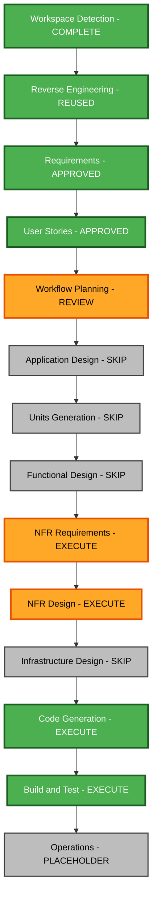

# Duc Tuan Portfolio - Execution Plan

## Basis and status

The user approved the requirements, story plan, and generated eight stories/two personas in successive review gates. This execution plan was explicitly approved by the user response "approve and continue". The input questionnaire is A / B / C: replace the portfolio; disable the optional Security Baseline and PBT extensions. The original privacy constraint is mandatory.

Inputs: [requirements](../requirements/duc-tuan-requirements.md), [stories](../user-stories/duc-tuan-stories.md), [personas](../user-stories/duc-tuan-personas.md), [discovery](duc-tuan-workspace-detection.md), and existing reverse-engineering context checked against current source.

## Scope and impact

- **Transformation**: presentation and content customization within one existing static application; no platform migration.
- **Public experience**: replace the existing owner's portfolio with Duc Tuan's English analytics portfolio. Make Business the proposed default and customize it around an analytical report aesthetic. Both reachable styles must use Duc Tuan's content and obey the privacy boundary; no third template is required.
- **Components**: update existing shell, hero, background, project, skills/certificate, navigation, and footer boundaries. Use existing controls and inline project detail patterns where possible. No new service, API, database schema, or algorithm is planned.
- **Content/data**: replace shared typed content, omit unsupported contact/download actions and unrelated sections, use a typographic identity, and remove superseded current-source assets where unused. Small optional-field adjustments can support missing content without inventing details.
- **Delivery**: retain React, TypeScript, Chakra, Vite, hash navigation, and GitHub Pages compatibility. Keep dependencies unchanged unless implementation evidence demonstrates a need.
- **NFR impact**: privacy of public source and output, accessible/responsive interaction, certificate review, and reliable static navigation.
- **Operations**: no new hosted service, tracking integration, logging backend, cloud resource, or infrastructure configuration is needed.

## Dependencies and change priority

| Boundary | Change and reason | Priority |
| --- | --- | --- |
| Shared content and assets | Major content replacement; authoritative input to both styles | Critical |
| Existing Business presentation | Major visual customization inside existing components; proposed default analytics theme | Critical |
| Shared and Engineering presentation | Compatible changes for correct Duc Tuan identity, optional content, accessible evidence, and no old-owner links | Critical |
| App, layout hook, template registry | Configuration/compatible changes only as required for default style and enabled sections; retain routing ownership | Important |
| Tests and build verification | Update user-facing expectations and verify privacy/navigation/certificates | Critical |
| Metadata and public documentation | Replace obsolete identity and explain safe asset maintenance | Important |
| Existing GitHub Pages workflow | Preserve delivery model; verify build compatibility | Important |

App resolves the selected template and enabled sections. The selected shell/sections consume shared typed data and approved assets. Data must therefore be replaced before validating presentation. Tests depend on the resulting public content and interactions. Historical reverse-engineering mentions a retired template; current source supports Engineering and Business and remains authoritative.

## Risk and rollback

Risk is medium: the work spans content, presentation, and assets; the primary material risk is unintentionally retaining private or wrong-owner material in public source/output. Rendering tests alone cannot establish privacy.

Review tracked files, public files, imported assets, and production output; use an allowlist for certificates; keep temporary extraction outside the repository; verify raw input ignore behavior. Assess Git history separately. Never rewrite history without explicit authorization, and do not claim this workflow can undo earlier exposure merely by deleting a current file.

Rollback is straightforward before publication because changes are local. If publication is later performed, retain the prior source/version for recovery, but never roll back by restoring identified private artifacts. Preserve unrelated user edits and local source inputs; do not use destructive reset/clean commands.

## Stage decisions

| Stage | Decision and depth | Reason |
| --- | --- | --- |
| Workspace Detection | Complete | Existing code and local inputs identified |
| Reverse Engineering | Reuse existing context | Core static architecture remains; refresh affected documentation with implementation |
| Requirements Analysis | Approved, standard | DT-01 through DT-11 establish scope and privacy |
| User Stories | Approved, concise | Eight stories describe reader and maintainer outcomes |
| Workflow Planning | Current review, standard | Coordinate one coherent application change |
| Application Design | Skip | Customize existing component boundaries; no new service/component architecture is needed |
| Units Generation | Skip | Single unit: duc-tuan-portfolio; no multi-service decomposition |
| Functional Design | Skip | No complex business logic, new algorithm, or database schema |
| NFR Requirements | Execute, concise | Define concrete privacy, accessibility, responsive, and static-delivery checks |
| NFR Design | Execute, concise | Specify reviewed asset flow, optional-content behavior, accessible evidence presentation, and verification |
| Infrastructure Design | Skip | Existing GitHub Pages static hosting remains suitable |
| Code Generation | Execute | Produce an explicit plan, obtain its approval, then implement and review the result |
| Build and Test | Execute | Run meaningful checks and prepare all required build/test instruction artifacts |
| Operations | Placeholder | Follow the AI-DLC placeholder; do not imply deployment has occurred |

Four execution stages remain after this plan is approved: NFR Requirements, NFR Design, Code Generation, and Build and Test. Code Generation includes separate planning and implementation parts. Stage duration depends on review responses and available preview/document inspection tools; no fixed timeline is assumed. Each executed stage creates its required artifacts at concise depth. Skipped stages remain available for user override.

## Workflow visualization

Text alternative: Workspace Detection complete; existing reverse-engineering context reused; requirements and stories approved; Workflow Planning review; skip Application Design, Units Generation, and Functional Design; execute NFR Requirements and NFR Design; skip Infrastructure Design; execute Code Generation planning/implementation and Build and Test; Operations remains a placeholder. Review gates apply at the boundaries specified by the repository rules.

## Single-unit change sequence

1. Review local inputs and certificate candidates in temporary storage. Inspect the six Kaggle PNGs and two Coursera PDFs for course labeling, links, metadata, and private details. Record an allowlist containing public-safe decisions, not private contents.
2. Replace shared identity and content, including source-grounded project narratives. Omit unverified ranking claims and unsupported links. Keep private source documents and the raw presentation outside the public asset set.
3. Customize the existing Business presentation around the analytics brief, update the default selection, and ensure both reachable styles display only Duc Tuan content. Retain static navigation and existing accessibility mechanisms.
4. Integrate reviewed certificates, in-site case-study access, missing-contact behavior, responsive styles, and reduced-motion behavior. Remove superseded assets from the current publishable source where unused, preserving ignored local inputs and audit history.
5. Update metadata, relevant tests, public documentation, and affected architecture descriptions. Run the appropriate standard suite and production build, inspect public/output assets, and complete visual/keyboard checks where preview tools are available.
6. Present concrete implementation and verification evidence at the specified review gates. Record remaining browser, historical-source, or inspection limits accurately. Publication must not precede privacy verification.

This sequence is the scope for subsequent detailed code-generation planning, not authorization to skip its approval gate.

## Success criteria and verification

- DT-US-01 through DT-US-08 and DT-01 through DT-11 are covered by the final review.
- Duc Tuan identity is consistent across reachable pages, metadata, and accessible controls.
- Three case studies communicate problem, methods, contribution, and takeaway without invented outcomes or unavailable external actions.
- Only individually reviewed normal certificates appear in source/output; labels match reviewed evidence.
- Raw DOCX/ZIP and private credentials remain excluded from new public files and output. Git history findings are reported separately without exposing private content.
- Mobile, keyboard, certificate, and hash-navigation behavior are checked; reduced motion is respected.
- The standard test suite and TypeScript/Vite build pass. Meaningful failures are resolved before review. Preview limits are recorded.
- Required build instructions, unit/integration/performance instructions, and verification summary are created under construction/build-and-test; performance load testing can be marked N/A with rationale for a static site.
- No cloud-scale monitoring or backend integration test is implied by static component/navigation checks.

## Workflow planning checklist

- [x] Load approved requirements, answered questions, stories, personas, and architecture context.
- [x] Assess transformation scope, related boundaries, risk, and dependencies.
- [x] Choose execute/skip decisions and concise depth for remaining stages.
- [x] Define the single-unit change sequence and success criteria.
- [x] Validate limited Mermaid syntax, node references, styling declarations, Markdown structure, and text alternative before file creation.
- [x] Update state/index and append the audit and approval prompt.
- [x] Receive explicit execution-plan approval - user response "approve and continue".

## Remaining stage tracking

- [x] NFR Requirements - concise assessment and technology artifacts generated.
- [x] NFR Requirements Review - explicitly approved.
- [x] NFR Design - concise design artifacts generated and validated.
- [x] NFR Design Review - explicitly approved.
- [x] Code Generation Part 1 - detailed nine-step plan generated and validated.
- [x] Code Generation Plan Approval - explicitly approved.
- [x] Code Generation Part 2 - implementation and verification complete.
- [ ] Generated Code Review Approval
- [ ] Build and Test - execution, instructions, summary, and review.

## Extension compliance

Security Baseline: disabled by Q2 B; skip its SECURITY rules. Property-Based Testing: disabled by Q3 C; skip its PBT rules. No enabled extension findings block this plan. Privacy, accuracy, accessibility, and standard tests remain mandatory under the original request and approved requirements.
